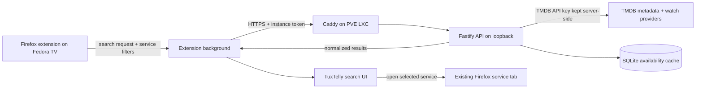

# TuxTelly global search and server implementation plan

Status: **Superseded for the first release.** The owner chose direct TMDB access
from the Firefox extension to avoid server operations. See
[`global-search.md`](global-search.md) for the implemented local-first design.
This document records the deferred server option for future multi-device or
shared-key needs.

## Objective

Let a viewer search once for a movie or show, then see which selected streaming
services report offering it in the configured country. The viewer can include or
exclude services and open a result in the relevant TuxTelly Firefox tab.

This first release searches catalog and regional availability data. It cannot
verify that a specific logged-in account, profile, subscription tier, parental
control setting, or temporary promotion makes a title playable. The streaming
providers' sessions stay in Firefox on the Fedora TV laptop; the server never
receives provider passwords, cookies, or session tokens.

## Data-source decision

Use TMDB for movie and TV metadata and its movie/TV watch-provider endpoints for
country-level availability. TMDB documents its watch-provider data as powered by
JustWatch; the endpoint reports providers per country, does not provide full
provider deep links, and requires JustWatch attribution. TMDB also requires its
own attribution and describes its free API as non-commercial use; commercial use
requires a separate license. These terms need to be reflected in the UI and
reviewed before offering a hosted public service. References: [TMDB watch
providers](https://developer.themoviedb.org/reference/tv-series-watch-providers),
[TMDB API FAQ and attribution](https://developer.themoviedb.org/docs/faq).

Do not scrape undocumented Netflix, Disney+, Max, or Prime Video endpoints and
do not send provider cookies to the server. No public consumer catalog-search
API was identified for those services. Disney's published media-feed
specification is intended for partners. JustWatch's direct content-partner API
requires a partner token after a contract. References: [Disney partner feed
specification](https://specs.disneystreaming.com/media-metadata-feed/spec.html),
[JustWatch partner API](https://apis.justwatch.com/docs/api/).

YouTube is a distinct case. Google has a documented YouTube Data API search
endpoint, but it searches public YouTube videos and is not a reliable way to
search an account's paid movie catalog. Keep YouTube public-video results as a
separate later connector with its own API key and quota handling; do not merge
random videos into movie/show matches. Reference: [YouTube Data API
search](https://developers.google.com/youtube/data/reference/rest/v3/search/list)
and [quota documentation](https://developers.google.com/youtube/v3/getting-started#quota).

## Proposed architecture



The extension background performs the network request. The bundled extension UI
and optional hosted launcher send it a typed runtime message, and the background
fetches the configured server endpoint. This keeps the instance token out of the
web launcher and avoids making the API depend on browser CORS behavior. The
extension requests Firefox permission for the configured server origin when the
owner saves or tests the connection.

The server uses a fixed TMDB base URL. It accepts search terms, country, title
type, and provider IDs; it never accepts arbitrary upstream URLs. This avoids
turning it into an SSRF proxy.

## Selected stack

| Area                     | Selection                                                                                                    | Reason                                                                                                                                                                                               |
| ------------------------ | ------------------------------------------------------------------------------------------------------------ | ---------------------------------------------------------------------------------------------------------------------------------------------------------------------------------------------------- |
| Runtime                  | Node.js 24 LTS                                                                                               | Matches the existing TypeScript/Node workspace and is suitable for a small continuously running service.                                                                                             |
| HTTP API                 | Fastify 5, TypeScript                                                                                        | Small JSON API, plugin ecosystem, and explicit route boundaries. Fastify 5 supports current Node LTS releases.                                                                                       |
| Validation               | Existing Zod package and shared `@tuxtelly/core` types                                                       | Reuse the repo's schema conventions; validate every request and upstream response at the boundary.                                                                                                   |
| TMDB client              | Native Node `fetch` plus a small typed adapter                                                               | Avoid a large client dependency and make timeout, retry, and cache behavior visible.                                                                                                                 |
| Persistence              | SQLite via `better-sqlite3`                                                                                  | One LXC, low write volume, durable TTL cache, easy backup. The Node built-in SQLite API is still marked release candidate in current Node 24 docs, so do not base the first stable deployment on it. |
| Rate/concurrency control | Small in-process limiter and bounded fan-out (maximum 4 upstream requests at once)                           | Protects TMDB quota and keeps a search bounded without adding Redis or a job queue.                                                                                                                  |
| Logging                  | Fastify/Pino with explicit redaction                                                                         | Operational health without writing search text, bearer tokens, or API keys to logs.                                                                                                                  |
| Deployment               | Debian 13 unprivileged PVE LXC; Node process managed by systemd; Caddy terminates HTTPS and proxies `/api/*` | Avoids nested Docker/Podman inside LXC for a single small process and reuses the existing Caddy deployment pattern.                                                                                  |
| Tests                    | Existing Vitest, Fastify `inject`, stubbed TMDB HTTP, and Firefox WebDriver suite                            | Keep deterministic checks in the current monorepo and test the real extension-to-server message path separately.                                                                                     |

Fastify 5's supported Node floor is Node 20+, and Node 24 is the project target;
the current built-in SQLite module is still documented as release candidate, so
the plan chooses the mature native SQLite package instead. References: [Fastify
v5 migration guide](https://fastify.dev/docs/v5.10.x/Guides/Migration-Guide-V5/),
[Node 24 SQLite status](https://nodejs.org/download/release/latest-v24.x/docs/api/sqlite.html).

## API contract

All endpoints are versioned under `/api/v1`. Search is a `POST` so search terms
do not appear in ordinary URL access logs.

### `POST /api/v1/search`

Request:

```json
{
  "query": "The Last of Us",
  "region": "US",
  "mediaTypes": ["movie", "tv"],
  "serviceIds": ["netflix", "disney", "hbo", "prime"],
  "availabilityTypes": ["flatrate"]
}
```

Validation limits: trimmed query 2–120 characters; ISO 3166-1 alpha-2 region;
one or both media types; 1–12 known service IDs; 1–4 availability types; maximum
20 candidates per page. Default availability is subscription (`flatrate`). The
settings UI may later offer free/ad-supported, rental, and purchase categories.

Response:

```json
{
  "query": "The Last of Us",
  "region": "US",
  "results": [
    {
      "tmdbId": 100088,
      "mediaType": "tv",
      "title": "The Last of Us",
      "year": 2023,
      "overview": "...",
      "posterPath": "/...jpg",
      "matchedServices": [
        { "serviceId": "max", "name": "Max", "availability": "flatrate" }
      ]
    }
  ],
  "nextPage": null,
  "attribution": ["TMDB", "JustWatch"]
}
```

Only titles with an offer matching at least one selected service and availability
type are returned. A title can have several matching services. Results are
sorted by TMDB search relevance; the server must not imply that provider
availability equals account entitlement. Poster URLs are formed from TMDB image
configuration, validated to the TMDB image host, and rendered with attribution.

### `GET /api/v1/providers?region=US`

Returns the provider list for a region and media types, normalized to TuxTelly
service IDs where a mapping is known. The UI uses it to show which services can
be searched in that region. Unknown or ambiguous provider names must be surfaced
for owner selection in settings instead of guessed.

### `GET /health/live` and `GET /health/ready`

Liveness confirms the process is running. Readiness checks configuration and
SQLite access but does not call TMDB. Responses disclose no keys, tokens,
absolute paths, or environment values.

### Errors

Return a stable JSON shape: `{ "error": { "code", "message", "requestId" } }`.
Use `400` for invalid filters, `401` for a missing or invalid instance token,
`429` for local rate limits, `502` for invalid TMDB credentials or malformed
upstream data, and `503` for upstream timeout/rate limiting. If metadata search
succeeds but some availability lookups fail, return the successful matches with
`meta.partial: true` and a non-sensitive per-provider status.

## Search and provider matching flow

1. Normalize the query for short-lived in-memory deduplication (trim, collapse
   spaces; do not remove meaningful punctuation). Reject too-short and
   overlong input.
2. Validate selected TuxTelly service IDs and map them to TMDB provider IDs for
   the requested region. Filter unknown services out with an explicit error or
   warning; never silently return an unfiltered catalog.
3. Call TMDB multi-search, then retain only movie and TV results. Ignore people
   results for the first release. Preserve TMDB's relevance order and cap the
   work to 20 results per page.
4. For each candidate, fetch the corresponding movie or TV watch-provider data
   for the region. Use bounded concurrency and a 5-second upstream timeout.
   Availability is keyed by TMDB media type, title ID, and region.
5. Filter offers by selected provider IDs and selected availability types. Map
   provider IDs back to TuxTelly service IDs and return only matches.
6. Return normalized metadata and attribution, not raw TMDB payloads or URLs.
   The frontend renders provider badges and an “Open in service” action.
7. On selection, TuxTelly opens the matching service tab and navigates to the
   provider's own search page when a tested search URL pattern exists; otherwise
   it opens the service home page and leaves search/navigation to the provider.
   Do not promise stable deep links until tested per provider.

TMDB search and watch-provider lookups are separate operations. A first pass can
require one search call plus one provider lookup per candidate. Keep the first
page bounded, use a 12-hour persistent availability cache and a 5-minute
in-memory search-result cache, and cap concurrent upstream work. If latency or
quota proves too high, the next decision is a licensed partner feed/API, not
private provider scraping.

## Include/exclude behavior and UI

- Add a **Search** destination to TuxTelly Home. The initial focus lands in the
  query field; Home and F8 remain available.
- Add chips or checkboxes for enabled services. All supported services are
  selected by default; users can turn individual services off. Search submits
  the selected IDs, and changing a selection refreshes results.
- Display which providers matched each title and label the scope “Reported in
  [region]” rather than “Available on your account.”
- Add a region selector with an explicit default (US for the first deployment)
  and save it per Firefox profile. Do not infer it from IP without telling the
  user.
- Keep subscription, free/ad-supported, rental, and purchase offers distinct.
  Subscription-only is the default so “included with my service” is not confused
  with a rental price.
- Provide loading, no-match, offline, partial-provider, bad-server-token,
  unavailable-region, and server-not-configured states. Include a direct link to
  connection settings from every setup error.
- Use a 300 ms debounce, cancel obsolete searches, keep the search text in
  in-memory UI state only, and avoid automatic searches on every keystroke until
  a query is stable.
- The service selector is an availability filter, not a check of which streaming
  sessions are logged in. Existing per-service browser login remains independent.

## Repository changes when implementation is approved

```text
apps/server/                     Fastify entry point, routes, config, lifecycle
packages/search/src/              Shared request/response and provider mappings
packages/ui/src/                  Search view, filters, cards, empty/error states
apps/extension/entrypoints/       Background search messages and connection storage
deploy/caddy/                     HTTPS reverse-proxy route for /api/*
deploy/systemd/                   LXC service unit and environment template
deploy/lxc/                       Reproducible install, upgrade, backup, rollback scripts
tests/server/                     Fastify route, cache, mapping, timeout tests
docs/global-search-server-plan.md This plan and later operational details
```

The first PR should add the server package, schemas, mocked TMDB adapter, and
API tests only. A second PR adds the extension message bridge and UI. Deployment
scripts and the PVE trial follow after local end-to-end tests pass.

## Settings and secrets

Server-side variables:

```text
TMDB_API_KEY=...                 # server only
TUXTELLY_API_TOKEN=...            # random instance token required by clients
TUXTELLY_BIND=127.0.0.1
TUXTELLY_PORT=8787
TUXTELLY_DATA_DIR=/var/lib/tuxtelly
TUXTELLY_DEFAULT_REGION=US
LOG_LEVEL=info
```

The TMDB key and bearer token live in `/etc/tuxtelly/server.env`, mode `0640`,
owned by `root:tuxtelly`; they are never in Git, the client bundle, API
responses, or logs. Client endpoint and bearer token live in dedicated Firefox
extension-local storage, separate from the exported user configuration and
diagnostic report. The token is masked in the settings UI and can be rotated by
changing the LXC environment file and reconnecting the TV. Never put the token
in a URL or query parameter.

Search terms are sensitive. Access logs contain route, status, duration, and
request ID only; redact the request body and Authorization header. Do not retain
search history. SQLite stores public provider availability keyed by title and
region, not raw search strings; expire records after 12 hours and expose a
“Clear server cache” admin action. Database backups contain only this cache.

## Security and non-functional requirements

- API is read-only and bound to loopback behind Caddy TLS; only the configured
  LAN hostname is exposed. No public port forwarding is part of the default
  install.
- Require a high-entropy bearer token for `/api/v1/*`. Compare secrets safely,
  rate-limit each client, cap request body size, validate all fields, and use a
  strict upstream host allowlist.
- Caddy serves the optional static launcher and proxies `/api/*` to Fastify.
  If the UI is bundled in the extension, the background fetch uses the explicit
  server-origin host permission. Do not use wildcard CORS. If a hosted launcher
  later calls the API directly, allow only its exact HTTPS origin.
- Do not log search terms, TMDB key, bearer token, provider cookies, or account
  information. Error messages are generic and include a request ID for local
  troubleshooting.
- Upstream timeout: 5 seconds per request; bounded concurrency: 4; retry at most
  once for transient network/5xx errors with short jitter; do not retry 4xx or
  TMDB quota responses blindly.
- Cache availability for 12 hours, provider directory for 24 hours, and search
  aggregates in memory for 5 minutes. Cache TTLs are configuration values and
  must be visible in diagnostics without exposing records.
- Target search response p95 under 2 seconds when cache is warm, under 5 seconds
  for a cold first page; memory below 256 MiB under normal TV use; one process,
  one LXC, no Redis or message queue.
- Degrade clearly when TMDB is down or quota-limited. The TuxTelly Home, service
  tabs, and playback must continue to work when the search server is offline.
- Keep the API compatible across extension and server minor versions with
  protocol versioning and explicit unsupported-version errors.

## PVE LXC deployment

Recommended initial container: **unprivileged Debian 13 LXC**, 1 vCPU, 1 GiB
RAM, 8 GiB disk, static DHCP reservation, and no nested container engine. This
is deliberately a little larger than the existing static-file-only LXC because
the API adds Node, SQLite, logs, and upgrade space. Increase resources only if
measurements justify it.

Deployment layout:

```text
/opt/tuxtelly-server/releases/<version>/   immutable application release
/opt/tuxtelly-server/current               symlink to active release
/var/lib/tuxtelly/search.sqlite             durable cache database
/etc/tuxtelly/server.env                   root-owned secrets/config
/etc/systemd/system/tuxtelly-server.service systemd unit
Caddy :443                                 TLS and /api/* reverse proxy
Fastify 127.0.0.1:8787                     private application listener
```

The installer checks Debian/Node versions, creates a dedicated `tuxtelly` user,
installs the release from a checksummed tarball, writes the service unit, applies
SQLite migrations, and leaves existing secrets/data untouched. Run Fastify as
the dedicated non-root user with a read-only release tree and write access only
to `/var/lib/tuxtelly`. The systemd unit restarts on failure and enables
`NoNewPrivileges`, `ProtectSystem=strict`, `ProtectHome`, `PrivateTmp`, and
`ReadWritePaths=/var/lib/tuxtelly`.

Caddy terminates TLS and proxies `/api/*`; Fastify never listens on the LAN
interface. The TV connects to `https://<trusted-lan-host>/api/v1`. Use a
hostname whose certificate Firefox trusts. If using Caddy's internal CA, install
and trust that CA on the Fedora TV and verify it in Firefox before storing the
endpoint. Do not fall back to ignoring certificate errors. Open only HTTPS from
the TV VLAN/LAN to the Caddy port in the PVE firewall.

Upgrade is release-directory based: unpack and verify a new release, run
migrations, switch `current`, restart, run health and smoke checks, and retain
the previous release for rollback. Back up SQLite using its online backup API
or stop the service for a consistent copy; back up `/etc/tuxtelly/server.env`
separately with restricted access. Restore procedure must cover data and secret
rotation.

## Development and implementation phases

### Phase 0 — API and terms spike

- Use the owner's TMDB key locally via an ignored `.env.local`; never ask them to
  paste it into chat or commit it.
- Verify multi-search, movie/TV provider lookups, region provider directories,
  poster URL behavior, and provider ID mapping for US Netflix, Disney+, Max, and
  Prime Video.
- Measure one cold query's request count, latency, and quota cost for 20 results.
- Confirm the provider mapping and attribution wording. Record that these results
  describe regional listings, not signed-in entitlement.
- Decide whether to include TMDB public use in the app's About/credits UI and
  whether JustWatch credit is visible on result cards and credits.

Exit: one prototype query returns correctly filtered and attributed results, and
TMDB terms fit the intended distribution.

### Phase 1 — Server foundation and contract

- Add `apps/server` to the pnpm workspace with Fastify, Zod, SQLite repository,
  config loading, health routes, request IDs, and redacted logging.
- Add shared search schemas and stable error/response types to
  `packages/search`.
- Add TMDB adapter with injected `fetch`, fixed API origin, strict response
  parsing, abort timeout, bounded concurrency, and clear quota/error mapping.
- Add SQL migration for TTL cache, SQLite WAL, prepared statements, and expiry
  cleanup. Do not store raw search strings.
- Implement `/api/v1/providers` and `/api/v1/search`; require bearer token and
  add rate/body/query limits.
- Test with TMDB HTTP stubs, not the live API. Add one opt-in live smoke command
  that requires an environment key and only prints counts/status.

Exit: local API starts with one command; every route validates inputs, protects
secrets, and passes deterministic unit/route tests.

### Phase 2 — Extension connection and search UI

- Add server URL and token settings to extension-local storage, not the
  transferable config object. Mask token entry and add Test connection,
  Save, and Remove actions.
- Request the server hostname permission from an explicit user click. Fetch via
  extension background messages; add message schemas and an allowlisted bridge
  for the hosted launcher.
- Add Search view, text query, provider include/exclude chips, region setting,
  loading/no-result/partial/offline/error states, result cards, and attribution.
- Debounce and cancel stale queries. Keep search term only in view memory. Do
  not include it in diagnostics, service settings export, URLs, or telemetry.
- On a match, activate the existing service tab and route to a tested provider
  search page where available; otherwise land on that service's home page.

Exit: Firefox integration test proves settings persist, token never reaches the
launcher JavaScript, query results render, filters apply, and service launch
works without losing existing logins or duplicating tabs.

### Phase 3 — LXC deployment and LAN acceptance

- Add systemd unit, environment template, release tarball, install/upgrade/
  rollback scripts, SQLite backup/restore scripts, and Caddy route.
- Deploy first to a test LXC with sample secrets; verify TLS trust, firewall,
  token rejection, service restart, cache migration, and rollback.
- Configure the TV endpoint and token through extension Settings; grant server
  origin permission; run a live query and check the result against provider
  websites in the same region.
- Reboot PVE and Fedora independently, then confirm API health, search recovery,
  Home offline behavior, and preserved Firefox service sessions.

Exit: documented install from clean LXC to live TV search succeeds, and restoring
the last backup returns service without re-entering provider logins.

### Phase 4 — provider coverage and hardening

- Expand service matching to all configured TuxTelly providers and add explicit
  handling for provider aliases, regional gaps, and multiple offer types.
- Evaluate an official YouTube Data API connector separately; allow users to
  supply a second key and display quota errors without affecting TMDB search.
- Add cold/warm latency metrics, bounded concurrency tests, quota exhaustion,
  upstream outage and stale-cache tests, and an overnight LXC soak.
- Review TMDB/JustWatch attribution and commercial-use terms before public
  release. Do not add unofficial provider scraping as a fallback.

Exit: acceptance matrix covers US provider mapping, no-match and partial cases,
cache behavior, service launch, API restart, backup/restore, and documented
known limits.

## Acceptance criteria

- Search finds expected movie and TV candidates and displays correct service
  badges for the configured region.
- Turning off any service removes its offers and does not suppress matches on
  the remaining selected services; selecting none prompts for at least one.
- Subscription, free/ad-supported, rental, and purchase offers remain distinct.
- Search results explicitly describe regional provider data and never imply
  account entitlement or login state.
- Service selection opens the corresponding existing Firefox tab and provider
  session remains entirely in Firefox.
- Invalid tokens, TMDB quota exhaustion, timeouts, malformed data, offline
  server, and unsupported region show actionable messages without breaking Home.
- Search text and both API credentials are absent from logs, exported config,
  diagnostics, client bundles, and HTTP URLs.
- API uses HTTPS from the TV, rate limits requests, and rejects unauthenticated
  calls. Health endpoints disclose no secrets.
- Cache expires, can be cleared, survives restart, and can be backed up/restored.
- Warm search p95 is under 2 seconds and cold first-page search p95 under
  5 seconds in the LAN acceptance environment.
- Existing `pnpm check` and Firefox integration tests remain green; all new
  server tests are deterministic and do not depend on TMDB availability.

## Open decisions with proposed defaults

| Decision                 | Proposed default                                             |
| ------------------------ | ------------------------------------------------------------ |
| Initial region           | US, configurable per Firefox profile                         |
| Availability filter      | Subscription/flatrate only                                   |
| Default services         | All enabled services with a verified TMDB mapping            |
| Server auth              | One random per-instance bearer token, rotated by the owner   |
| Search retention         | No history; 5-minute in-memory aggregate cache only          |
| Availability cache       | SQLite, 12-hour TTL, clearable                               |
| Public YouTube results   | Separate optional connector in a later phase                 |
| Provider login detection | Not implemented; never read provider cookies                 |
| First deployment         | Debian 13 PVE LXC, systemd Node service, Caddy TLS proxy     |
| Hosted public service    | Out of scope; each self-hosted owner supplies their TMDB key |
