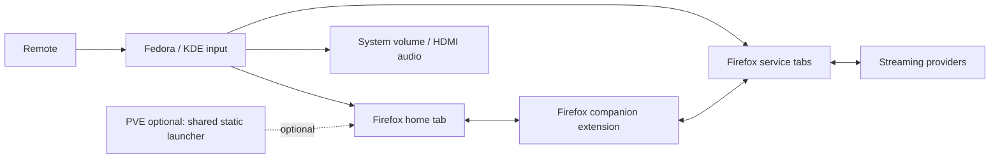

# TuxTelly project plan

Status: **Approved; initial preview implemented, release qualification in progress.**

This document records the approved project scope. Requirements below describe the
intended release, including work still pending. For implemented behavior and
remaining gates, see the implementation roadmap and acceptance checklist.

## Goal and reference setup

Build an open-source, self-hosted frontend that turns a Linux laptop connected to
a TV into a remote-controlled streaming interface. Services remain ordinary
Firefox tabs, retaining their normal authentication and DRM behavior.

Reference setup:

- Fedora 44, KDE Wayland, Firefox 156 at `/usr/bin/firefox` (inspected on the laptop).
- Intel Core i5-1135G7, x86-64, 8 GB RAM.
- Rii MX3 2.4 GHz air mouse/keyboard remote, identified from the supplied listing.
- Local Firefox extension; optional Proxmox VE static hosting only if one shared launcher is later useful across TVs.
- Provider priority: YouTube, Netflix, Disney+, HBO Max.

## Architecture

| Component                | Responsibilities                                                                         |
| ------------------------ | ---------------------------------------------------------------------------------------- |
| Bundled Firefox Home     | TV home, service configuration, appearance, navigation settings, onboarding, diagnostics |
| Firefox extension        | Tabs, keyboard routing, permissions, adapters, local settings, recovery UI               |
| Optional hosted launcher | Shared static UI for multiple TVs; not needed for local playback                         |
| Fedora/KDE integration   | Persistent Firefox profile, autostart, fullscreen window, audio, system media keys       |
| Provider website         | Login, profiles, catalog, player, subtitles, playback, and DRM                           |

Video goes directly between the laptop and each provider. The local extension
contains the Home UI, configuration, and controls. No server, database, LAN, or
remote host is required. If several TVs later need a shared launcher, an optional
static host can serve the same UI; it never proxies video or holds credentials.

### Why an extension is required

Firefox pages cannot reliably inspect and control other origins' tabs because of
browser security boundaries. The extension supplies the Home UI, permitted content
scripts, and browser tab/window APIs. Adding a service URL enables launching;
reliable provider controls require adapters and validation.

### Configuration ownership

- Extension local storage is authoritative for device settings in Firefox.
- Local profile storage covers single-TV use and keeps settings on the TV.
- Optional shared hosted defaults may be added for multi-TV setups later.
- Imports are validated and migrated; retain the last valid configuration.
- JSON export/import provides backups and transfer between TVs.
- Automatic synchronization across TVs is deferred.
- Provider sessions remain in Firefox and are not included in configuration exports.

### Browser behavior

Use one dedicated, persistent TV profile and a designated managed window. Start
with ordinary browser fullscreen. Treat player fullscreen as a separate state;
Firefox may exit it on tab changes. Kiosk mode is a later, separately tested
deployment option because it changes browser controls and recovery behavior.

## Technology stack

| Area                 | Choice                                                      |
| -------------------- | ----------------------------------------------------------- |
| Language             | TypeScript, strict mode                                     |
| Local interface      | React UI bundled inside the Firefox extension               |
| Optional web UI      | React and Vite for a shared network launcher                |
| Styling              | Shared CSS and CSS custom properties                        |
| Extension            | WXT, Firefox Manifest V3, WebExtension APIs                 |
| Validation           | Zod, versioned configuration and message schemas            |
| State                | React state and serialized background operations            |
| Persistence          | browser.storage.local                                       |
| Optional hosting     | Caddy static files in an unprivileged Debian LXC            |
| Desktop integration  | KDE autostart/shortcuts, PipeWire/WirePlumber               |
| Build                | pnpm workspace, maintained Node.js LTS, locked dependencies |
| Unit/component tests | Vitest, Testing Library                                     |
| Firefox integration  | Selenium WebDriver, geckodriver                             |
| Checks               | TypeScript, ESLint, Prettier, web-ext lint                  |
| CI/releases          | GitHub Actions; static asset and extension artifacts        |
| License              | MIT (adopted)                                               |

Dependencies and exact versions are locked in the workspace. Local use needs no server runtime. Optional static hosting does not require Node.js.

## Functional requirements

### F01: Installation and onboarding

- Detect the extension and verify the launcher/extension protocol version.
- Open the bundled Home screen; no launcher origin or network host is required.
- Add services and request their necessary origin permissions.
- Calibrate the remote and explain unavailable or OS-consumed keys.
- Document a persistent Firefox TV profile and direct provider login/MFA.

### F02: TV home screen

- Large service tiles with clear focus and directional navigation.
- Enter/OK activation and pointer interaction.
- Ordering, groups, favorites, filtering, and prior-selection restoration.
- Adjustable tile size, spacing, colors, background, text scale, and overscan.

### F03: Service configuration

- Add, edit, disable, reorder, and remove services.
- Store stable ID, name, start URL, icon, permitted origins, adapter, and overrides.
- Recognize known providers and offer a generic adapter for other URLs.
- Report actual capabilities without implying universal keyboard compatibility.
- Handle additional provider origins and redirects through appropriate permissions.

### F04: Tab management

- One home tab and one managed tab per service by default.
- Open services lazily and reuse existing tabs without resetting their routes.
- Deduplicate repeated launch requests.
- Reconcile manual closures, redirects, restarts, crashed tabs, and stale IDs.
- Limit automation to the designated TV window and managed services.

### F05: Provider navigation

- Cover catalogs, rows, search, results, details, episodes, profiles, dialogs, and menus.
- Prefer working native keyboard behavior; supplement with spatial/provider logic.
- Preserve or restore selection across route changes and player exit.
- Keep modal navigation within the active dialog.

### F06: Spatial navigation

- Find visible, enabled interactive targets and select by direction.
- Scroll targets into view and show a focus indicator.
- Handle nested scroll areas and dynamically loaded content.
- Use adapters for virtualized rows and other structures generic navigation cannot resolve.
- Bound observers and work performed when the DOM changes.

### F07: Text and pointer interaction

- Preserve typing, cursor movement, deletion, selection, and input composition.
- Suppress single-letter playback shortcuts in editable contexts, including passwords.
- Preserve pointer behavior and provide a predictable return to keyboard focus.

### F08: Playback

- Play/pause and configurable backward/forward seek increments.
- Respect live seek ranges and unavailable controls.
- Identify the active player instead of assuming the first video element.
- Player volume and mute where available.
- Subtitle toggle or menu fallback, and access to audio/subtitle choices.
- Player fullscreen and safe exit behavior.
- Report unsupported or failed actions explicitly.

### F09: Cross-service navigation

- Home, next/previous service, and a service switcher.
- Configurable extension-command route home when page navigation fails.
- Recovery from pages where content scripts cannot execute.
- Reuse tabs and retain service page context where the provider allows it.

### F10: Switching playback policy

- Request pause before leaving a playing service by default.
- Confirm success where possible; use managed-tab mute fallback when necessary.
- Preserve the user's prior mute setting separately from extension-owned muting.
- Avoid unexpected autoplay when returning.
- Allow explicit per-service background-audio exceptions.

### F11: Remote mapping

- Calibration records key, code, modifiers, press/release, and repeat behavior.
- Map physical buttons to logical actions with service overrides.
- Configure repeat delay/rate and reliable long-press behavior.
- Identify assignment conflicts and provide recovery/reset controls.
- Route OS-consumed controls through KDE configuration as needed.
- Distinguish infrared-only controls from USB keyboard/mouse events.

### F12: Fullscreen

- Keep browser-window fullscreen across service switching.
- Distinguish browser fullscreen from provider/player fullscreen.
- Respect Firefox user-activation requirements.
- Remain navigable when browser-owned Escape behavior exits fullscreen.

### F13: Customization and persistence

- Configure keys, navigation wrapping, scrolling, seek steps, appearance, and service order.
- Validate and version configuration imports and exports.
- Migrate settings, retain last-valid configuration, and restore defaults.
- Keep local settings authoritative; define precedence if shared defaults are introduced.

### F14: Diagnostics

- Extension connection, permissions, adapter version, and capability status.
- Button tester and actionable recovery messages.
- Sanitized diagnostic export without typed input, cookies, or viewing details.
- Distinguish launch support, navigation support, and verified playback controls.

### F15: Failure recovery

- All local service controls continue without any server or network launcher.
- Bundle Home and retain the last valid configuration in the extension.
- Handle revoked permissions, missing players, changed DOM, and protocol mismatches.
- Provide a route home even when an adapter fails.

### F16: Startup and sessions

- Start the dedicated Firefox profile after KDE starts and enter browser fullscreen.
- Open the launcher and reconstruct managed tabs without duplicate launches.
- Preserve valid provider sessions through the normal Firefox profile.
- Avoid starting playback across restored tabs automatically.

## Input semantics

| Context/action                      | Default behavior                                                    |
| ----------------------------------- | ------------------------------------------------------------------- |
| Arrows in catalog                   | Move selection                                                      |
| Arrows in text field                | Edit text normally                                                  |
| Left/right in playback mode         | Seek                                                                |
| Enter/OK                            | Activate selected control                                           |
| Space or Play/Pause outside editing | Toggle playback                                                     |
| Back                                | Dismiss current overlay/menu, then navigate back within the service |
| Home                                | Launcher                                                            |
| Menu                                | Service switcher                                                    |
| Next/previous service               | Activate corresponding managed tab                                  |
| C outside editing                   | Captions toggle or caption menu                                     |
| F outside editing                   | Player fullscreen                                                   |
| F11                                 | Firefox browser fullscreen                                          |
| Volume/mute keys                    | KDE system volume by default                                        |
| Tab/Shift+Tab                       | Standard focus traversal fallback                                   |

Finalize physical mappings after calibration. Prevent one Back press from both
dismissing a dialog and leaving the page. Browser-reserved keys and OS-consumed
events cannot all be remapped from page code. System audio and per-player volume
are separate controls and must not both respond to the same event unintentionally.

## Adapter contract

Each adapter identifies origins/routes/context, reports capabilities, navigates,
activates selections, handles Back, locates the active player, executes playback
actions, observes relevant changes, restores selection, cleans up listeners/UI,
and reports unavailable or failed operations.

Ship a generic HTML adapter and provider adapters in the agreed priority order.
Publish a dated matrix of browsing, search, playback, seek, captions, fullscreen,
and switching results, including relevant browser, region, and account variants.

| Level           | Meaning                                                        |
| --------------- | -------------------------------------------------------------- |
| Launch          | Open, reuse, switch, return home                               |
| Generic         | Best-effort navigation and accessible HTML media controls      |
| Provider-tested | Documented navigation and playback flows pass on that provider |

Synthetic keyboard events are not a universal control strategy. Use DOM/media
capabilities and provider controls as appropriate, respecting trusted-user-action
requirements. Ship executable adapters inside extension releases. Imported data
may contain validated settings or limited declarative selectors, not arbitrary
downloaded JavaScript.

## Non-functional requirements

Performance values below are proposed measurement targets, not verified claims.

| Area             | Requirement                                                                                      |
| ---------------- | ------------------------------------------------------------------------------------------------ |
| Input latency    | Visible navigation feedback within 100 ms at p95 on reference laptop                             |
| Warm switching   | Activate an already-loaded tab within 300 ms, excluding provider/network rendering               |
| Launcher startup | Target interactive local Home within one second after Firefox is ready                           |
| Memory           | Lazy tabs, separately measured project overhead, optional inactive-tab unloading                 |
| CPU              | Event-driven updates and bounded observers; avoid continuous full-DOM scans                      |
| Display          | 1080p/4K desktop layouts, scaling, overscan, couch viewing                                       |
| Accessibility    | Clear focus, contrast, keyboard-complete owned UI, reduced motion, accessible names              |
| Reliability      | Recover from browser/tab/permission/adapter failures; local use has no server dependency         |
| Endurance        | Eight-hour viewing/switching soak without progressive failure or unbounded growth                |
| Privacy          | Provider credentials stay in Firefox; sensitive input/session/viewing data excluded from logs    |
| Telemetry        | No default analytics or external application telemetry                                           |
| Permissions      | Request needed configured origins, avoid unrelated browsing access                               |
| Messaging        | Validate schema, sender, origin, and managed-tab membership                                      |
| Security         | Restrictive content policy, validated URLs/config, bundled code, controlled assets               |
| Compatibility    | Fedora 44/current Firefox reference; publish minimum version and assess ESR                      |
| Maintainability  | Isolated adapters, documented interfaces, navigation regression fixtures                         |
| Upgrades         | Versioned protocols/schema, migrations, last-valid state, rollback                               |
| Distribution     | Installable extension, checksums, source/build instructions; optional static UI for multi-TV use |
| Operations       | Install, backup, restore, update, troubleshooting, removal; HTTPS only for optional hosted UI    |
| Open source      | License decision, contribution guide, security reporting, templates, changelog                   |

Measure streaming quality and decode performance independently. Firefox, codecs,
drivers, provider policy, and account support affect playback. 4K UI
support does not promise 4K provider playback.

## Local installation and optional shared hosting

The primary setup installs TuxTelly in a dedicated persistent Firefox profile on
the Fedora laptop. Service settings and authentication stay in that profile. The TV
needs no server process, database, PVE container, LAN address, or TLS certificate.

If multi-TV sharing becomes useful, host the static launcher with Caddy in an
unprivileged Debian LXC. A starter allocation is 1 vCPU, 512 MB RAM, and 4 GB disk;
use a network hostname with HTTPS trusted by each TV. The optional container needs
neither GPU nor remote USB access.

Laptop setup covers Firefox installation/signing, DRM/codecs, HDMI audio, KDE
autostart, mappings, sleep/lid behavior, fullscreen recovery, and reversible
desktop configuration.

## Scope after the first complete release

Deferred: unified cross-provider catalog, synchronized viewing history,
cross-device settings synchronization, phone control, HDMI-CEC/system power
integration, multiple isolated accounts per provider, and runtime adapter marketplace.

## References

- [Same-origin policy](https://developer.mozilla.org/en-US/docs/Web/Security/Defenses/Same-origin_policy)
- [Firefox content scripts](https://developer.mozilla.org/en-US/docs/Mozilla/Add-ons/WebExtensions/Content_scripts)
- [Optional host permissions](https://developer.mozilla.org/en-US/docs/Mozilla/Add-ons/WebExtensions/manifest.json/optional_host_permissions)
- [Firefox DRM](https://support.mozilla.org/en-US/kb/enable-drm)
- [Netflix browser requirements](https://help.netflix.com/en/node/30081)
- [Firefox kiosk behavior](https://support.mozilla.org/en-US/kb/firefox-enterprise-kiosk-mode)
- [User activation](https://developer.mozilla.org/en-US/docs/Web/Security/Defenses/User_activation)
- [WXT browser targeting](https://wxt.dev/guide/essentials/target-different-browsers.html)
- [Caddy static hosting](https://caddyserver.com/docs/quick-starts/static-files)
- [WirePlumber controls](https://pipewire.pages.freedesktop.org/wireplumber/man/wpctl.html)
- [Rii MX3 listing](https://www.amazon.com/dp/B01CL3ZXGO)

Provider requirements and site behavior change; recheck them in Phase 0.
